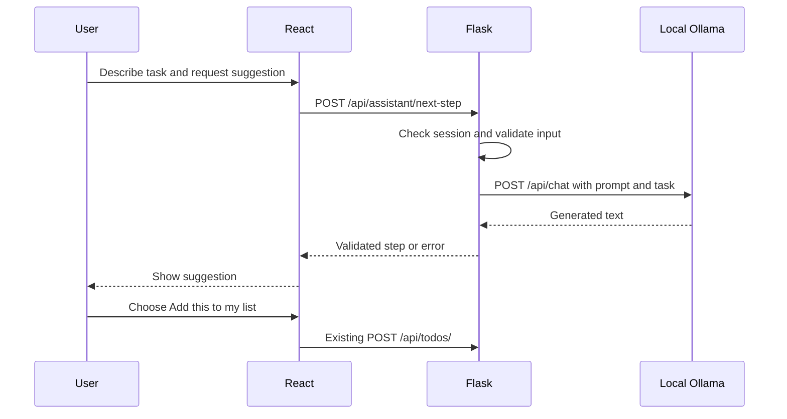

# Ollama integration

Date: 2026-09-20  
Branch: `codex/integrate-ollama`  
Related decision: [0001](../decisions/0001-local-ollama-integration.md)

## Problem and hypothesis

A broad task can leave someone unsure where to begin. A long generated plan can
create more decisions instead of making the first action clearer.

Hypothesis: a single concrete action with an observable finish can make starting
easier. This is a product hypothesis, not a validated accessibility or clinical
claim. The intended audience includes people who struggle to start tasks;
requirements must be tested.

## Scope

A signed-in user describes a task, requests one suggestion, and chooses whether
to save it as a todo. The first prototype uses an existing local `llama2` model.
Fine-tuning, chat history, automatic task creation, production inference hosting,
and medical guidance are outside this iteration scope.

## User flow

1. Enter a task in “Help me start.”
2. Click “Suggest one small action.” The UI shows a waiting message.
3. Read the suggestion or an error message.
4. Optionally click “Add this to my list.” This uses existing todo creation.

Suggestions are only saved when you click “Add this to my list.” Changing your task removes the old suggestion.
While the app is working, the input and buttons in this panel are temporarily unavailable.

## Architecture and code map

| File | Responsibility |
| --- | --- |
| `frontend/src/components/NextStep.jsx` | Input, waiting/error states, suggestion, explicit save |
| `frontend/src/api/assistant.js` | Request wrapper with a 100-second client deadline |
| `frontend/src/App.jsx` | Places the new component in the signed-in app |
| `frontend/src/index.css` | Styles the panel |
| `backend/app/routes/assistant.py` | Authentication, input validation, response status |
| `backend/app/services/ollama.py` | Prompt, HTTP call, response validation, service errors |
| `backend/config.py` | Model, service URL, 90-second network timeout |
| `backend/app/__init__.py` | Registers the assistant blueprint |
| `backend/tests/test_assistant.py` | Automated route/service-boundary checks |

## API contract

`POST /api/assistant/next-step`, using the existing signed session cookie.

Request: `{"task": "Start working on my app"}`  
Success: `{"step": "Open a note and write one sentence describing your app. Stop when saved."}`

- Task must be a string containing 1–1000 characters after trimming.
- An advertised request body over 8192 bytes is rejected. This Content-Length
  check is not a comprehensive transport-level request size limit.
- 200: suggestion returned; 400: invalid task; 401: no session; 413: advertised
  body too large; 503: unavailable model/service or unusable response.
- Returned text must be nonempty and at most 255 characters to fit a todo title.

## Model behavior and configuration

The system prompt asks for one action taking at most ten minutes, at most 40
words, and an observable finish. It discourages broad planning, multiple options,
and diagnostic advice. It contains a worked example.

These are instructions, not enforced guarantees. Code checks type and length;
it does not determine whether an action is useful, safe, singular, or achievable
in ten minutes. User text cannot change server configuration or invoke tools,
but can still influence model output contrary to the prompt.

- `OLLAMA_BASE_URL`: defaults to `http://localhost:11434`.
- `OLLAMA_MODEL`: defaults to `llama2`.
- `stream: false`: wait for a full response.
- `temperature: 0.2`: chosen to reduce variation; does not ensure determinism.
- `num_predict: 180`: generation token cap, separate from the character check.

The default route sends task text to local Ollama. Changing the service URL or
model can change where inference occurs; do not make unconditional privacy claims.
For setup, see [backend documentation](../../backend/README.md#local-next-action-assistant).

## Validation performed on 2026-09-20

- 50 backend tests passed, including 13 new assistant test cases.
- 28 existing HTTP integration tests passed against the local server.
- Frontend lint and production build passed.
- Browser check: signed into a local demo account, generated a real suggestion,
  saved it, and verified it appeared in the list.
- An initial test command from the repository root unintentionally included the
  server-dependent tests and failed under restricted network access. The regular
  suite passed from the backend directory; HTTP tests passed with network access
  and the correct local server URL.
- Dependency installation reported one high-severity npm audit finding. Its
  applicability has not been assessed in this integration.

These checks establish basic implementation behavior, not production readiness
or usefulness. One live response suggested broad research into business spaces;
another gave a concrete sentence-writing action. Quality is inconsistent.
